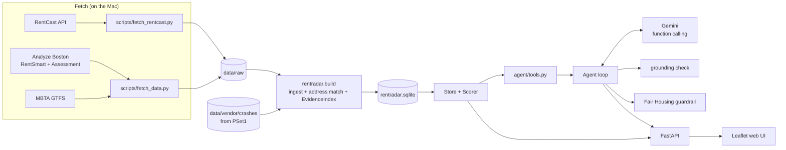

# Architecture

## Flow

## Build time vs request time

| Step | When | Why |
|---|---|---|
| Parse and normalize raw files | build | slow, deterministic, testable on fixtures |
| Listing ↔ record address match | build | O(listings × records on the same street) |
| Crash radius and corridor counts | build | spatial queries over about 35k crashes |
| Factor scores and weighted total | request | depends on the user's weights, budget and campus |
| Agent plan and explanation | request | depends on the user's text |

## Agent loop (`agent/agent.py`)

1. Guardrail: refuse and redirect if the request asks for steering by protected class.
2. The model gets the system prompt, the user text (plus the campus and weights from the UI) and 5 tool declarations.
3. While the model returns `functionCall` parts: run each tool, append a `functionResponse` and repeat (at most `AGENT_MAX_STEPS`, default 6).
4. Final text → grounding check. If a number isn't found in any tool output, send one corrective message ("these numbers are not in any tool result: …").
5. Return the answer, the tool trace, the plan (first `rank_listings` args and the weights used), the ranked IDs, the grounding result and token usage.
6. On any `LLMError` (no key, HTTP error, quota), run the offline planner over the same tools.

## Address matching

`address.parse()` produces a key from the street name and zip, plus a house-number range:

- `"40-42 Sample Avenue, Apt 3", 02134` → `SAMPLE AVE|02134`, 40–42
- Suffixes are normalized (STREET→ST, AVENUE→AVE, …), as are leading and trailing directions (NORTH→N).
- Unit designators are removed (`Apt`, `Unit`, `#`, `Fl`, …).
- Zips are left-padded (`2134` → `02134`). For RentSmart-style addresses, the zip is read from the end of the address string (`"256 Parker Hill Ave, 02120"`).

Match types are `address` (same range), `address_range` (overlapping) and `geo` (no address match; a record with coordinates within 20 m). The type is stored per link and shown in the UI.

## Why these technologies

- **SQLite.** One file, no server, and it fits hundreds of listings and a few hundred thousand records.
- **FastAPI.** Typed request models, automatic docs at `/docs`, and a `TestClient` for API tests.
- **Vanilla JS + Leaflet.** No build step. Leaflet is vendored, so the UI loads without a CDN.
- **Gemini over REST.** It has a free tier, function calling, and no SDK lock-in.
